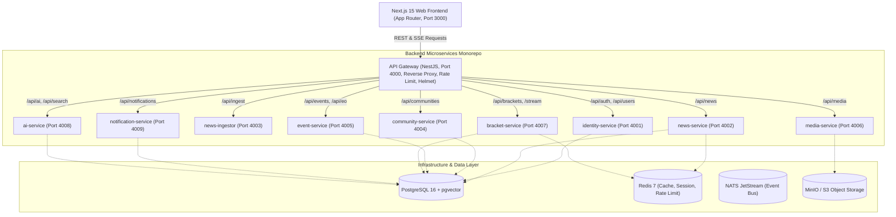
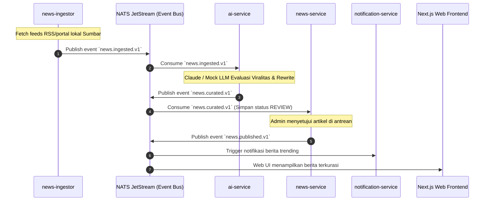
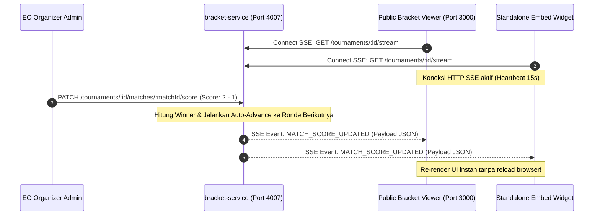
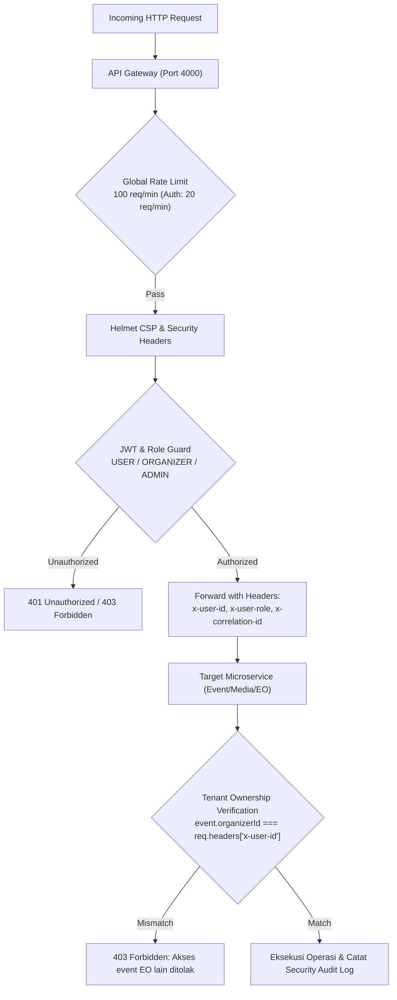

# 🏛️ ESPORT SUMBAR — Arsitektur Sistem & Spesifikasi Teknis

> **Portal Esport All-in-One Sumatera Barat**  
> Standar Arsitektur: *Microservices Monorepo*, *Event-Driven Architecture (EDA)*, *Tenant Isolation Keras*, *Realtime Server-Sent Events (SSE)*, dan *AI-Powered Content & Moderation*.

---

## 1. Diagram Arsitektur Sistem (High-Level Microservices)

---

## 2. Diagram Alur Data & Event Bus (Event-Driven Pipeline)

---

## 3. Diagram Bracket Engine & Realtime SSE Streaming

---

## 4. Model Keamanan & Tenant Isolation Keras

---

## 5. Direktori Port Layanan & Rute Gateway

| Service | Port | Tanggung Jawab Utama | Rute Gateway Proxy |
| :--- | :---: | :--- | :--- |
| **API Gateway** | `4000` | Entry point tunggal, Rate Limit, Helmet, Correlation ID | `http://localhost:4000` |
| **identity-service** | `4001` | Auth, Register, Login, Token Refresh Rotation, Profil, EO Status | `/api/auth`, `/api/users`, `/api/organizer` |
| **news-service** | `4002` | Portal berita, CRUD editorial, Bookmark, Trending Viral Score | `/api/news`, `/api/admin/news` |
| **news-ingestor** | `4003` | Background RSS crawler, SHA-256 deduplikasi, Ingest pipeline | `/api/ingest` |
| **community-service**| `4004` | Hub komunitas per game, forum diskusi, moderasi, anggota | `/api/communities`, `/api/admin/moderation` |
| **event-service** | `4005` | Wizard turnamen, Form Builder dinamis, pendaftaran peserta | `/api/events`, `/api/eo` |
| **media-service** | `4006` | Storage privat per event, kuota 50MB, HMAC-SHA256 signed URL | `/api/media` |
| **bracket-service** | `4007` | 6 format turnamen, Seeding, Auto-advance, Realtime SSE | `/api/brackets` |
| **ai-service** | `4008` | Kurasi Claude LLM, Moderasi teks, EO Assistant, Semantic Search | `/api/ai`, `/api/search` |
| **notification-service** | `4009` | In-app notification center, unread counter, event reminders | `/api/notifications` |
| **Next.js Web** | `3000` | Frontend UI App Router, Broadcast Viewer, Standalone Embed | `http://localhost:3000` |

---

## 6. Format Turnamen yang Didukung (Algoritma Bracket)

1. **SINGLE_ELIMINATION**: Sistem gugur tunggal standar kompetisi internasional dengan seeding rating/acak dan penanganan BYE otomatis.
2. **DOUBLE_ELIMINATION**: Bracket Upper & Lower (Losers Bracket) dengan babak Grand Final yang adil.
3. **ROUND_ROBIN**: Sistem setengah kompetisi, setiap tim bertanding satu sama lain dalam grup dengan akumulasi poin W-D-L.
4. **SWISS_SYSTEM**: Format kompetisi berpasangan berdasarkan rekor skor terkini tanpa eliminasi dini.
5. **GROUP_PLAYOFF**: Babak penyisihan grup dilanjutkan dengan bracket eliminasi untuk tim yang lolos kualifikasi.
6. **LEADERBOARD (BATTLE ROYALE)**: Format akumulasi poin khusus game Battle Royale (Free Fire / PUBG Mobile) dengan bobot Placement Point + Kill Point serta kriteria tiebreaker bertingkat (Total Poin $\rightarrow$ Total Placement $\rightarrow$ Total Kills $\rightarrow$ Skor Match Terakhir).
